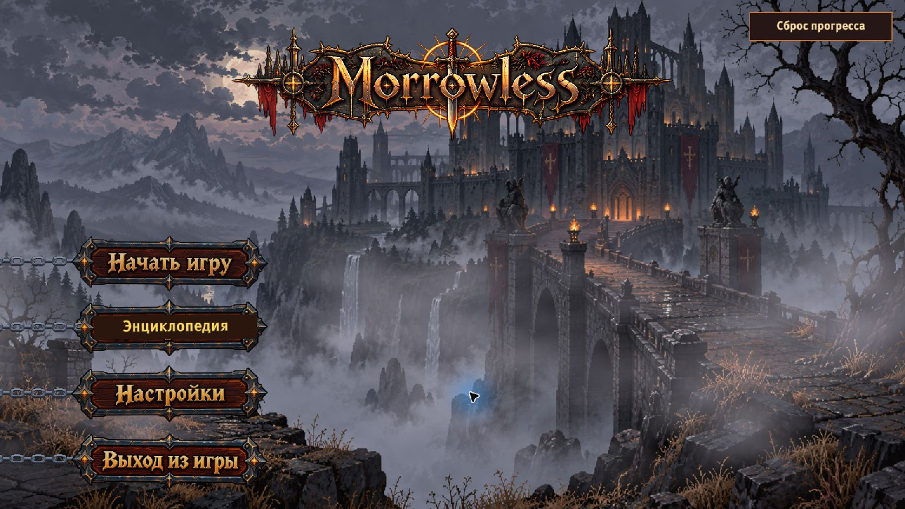
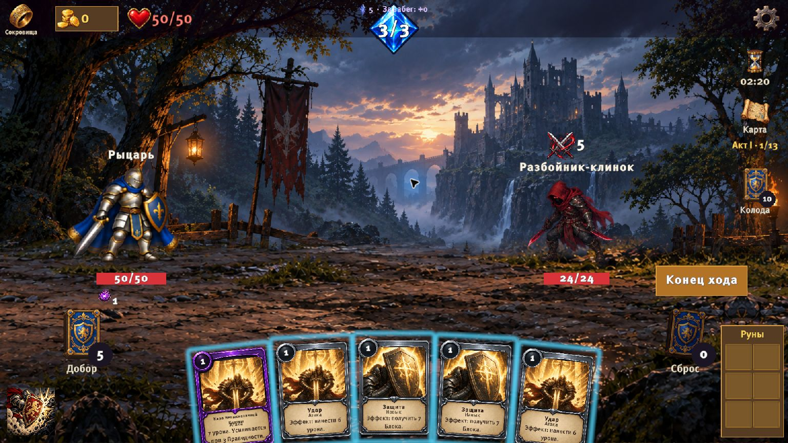
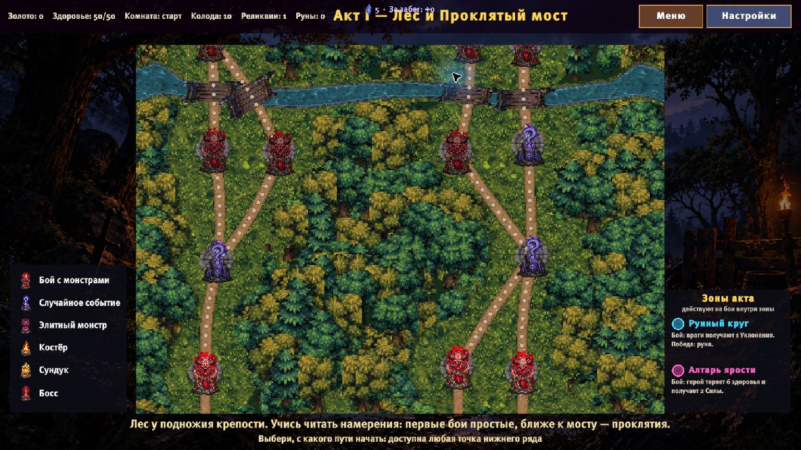
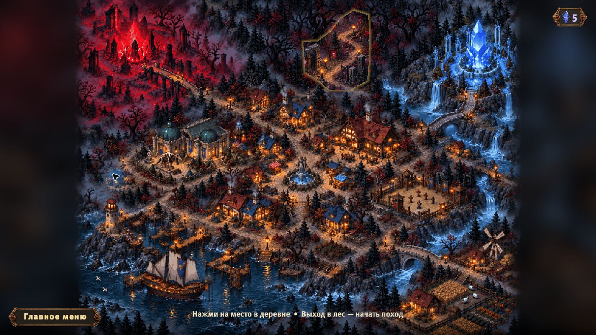

# MORROWLESS

**Мрачное фэнтези · Пошаговые бои · Roguelike deckbuilder**

Собери колоду. Прими Клятву. Пройди через проклятое королевство.

### [⬇ Скачать Morrowless 1.1.6 для Windows](https://github.com/Phalleeen/Morrowless/releases/download/v1.1.6/Morrowless-1.1.6-Windows-x64.zip)

**Windows x64 · Русский интерфейс · В разработке**

[Все релизы](https://github.com/Phalleeen/Morrowless/releases) · [Сообщить об ошибке](https://github.com/Phalleeen/Morrowless/issues)

## Об игре

**Morrowless** — одиночная карточная roguelike-игра в мрачном фэнтезийном мире. Вы отправляетесь в поход за паладина: собираете колоду, находите артефакты и выбираете маршрут через сражения, случайные события и встречи с боссами.

Читайте намерения противников, распределяйте энергию между атакой и защитой и стройте сочетания карт. Молитва, Тление и Кровотечение открывают разные способы вести бой, а выбор Клятвы и специализации помогает развивать выбранный стиль.

## Что ждёт в походе

- **Пошаговые карточные бои** — атаки, защита, особые карты и способность героя.
- **Развитие колоды** — новые карты в наградах, улучшения и сочетания эффектов.
- **Клятвы паладина** — направления Веры, Пепла и Крови.
- **Артефакты и руны** — дополнительные эффекты, меняющие тактику.
- **Карта с выбором пути** — обычные и элитные бои, события, сокровища и костры.
- **Город и метапрогрессия** — подготовка к следующему походу.

## Скриншоты

Реальные кадры Windows-билда **1.1.6**.

### Бой

### Выбор маршрута

### Город перед походом

## Скачать и запустить

1. Скачайте [архив игры для Windows](https://github.com/Phalleeen/Morrowless/releases/download/v1.1.6/Morrowless-1.1.6-Windows-x64.zip) — около **290 МБ**.
2. Полностью распакуйте его в отдельную папку.
3. Запустите **MorrowLess.exe**.

**Unity устанавливать не нужно.** Папки `MorrowLess_Data`, `MonoBleedingEdge` и остальные файлы должны оставаться рядом с EXE. Не запускайте игру непосредственно из ZIP.

В разделе Releases выбирайте **Morrowless-1.1.6-Windows-x64.zip**. Автоматические архивы **Source code** содержат материалы этой страницы, а не игру.

## Обратная связь

Игра находится в разработке: баланс, оформление и содержимое могут меняться.

Нашли ошибку? [Создайте Issue](https://github.com/Phalleeen/Morrowless/issues/new) и укажите версию игры, шаги воспроизведения, ожидаемый результат и то, что произошло. По возможности приложите скриншот.

---

Этот репозиторий содержит страницу игры, скриншоты и готовые сборки в Releases. Исходный Unity-проект здесь не опубликован.
